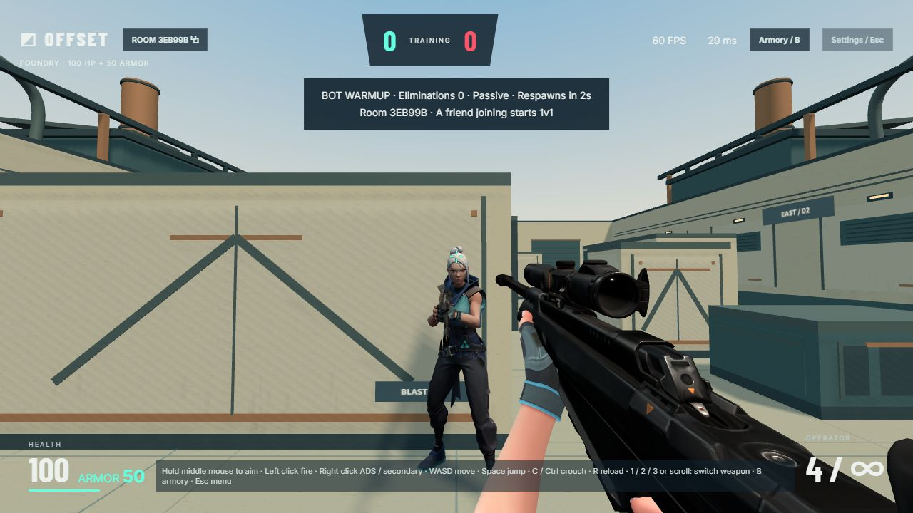

# OFFSET / Aim Duel

A browser-based 1v1 aim-training game inspired by VALORANT. Create a private room, share its link, and duel a friend from another device. This is an independent personal project, not coursework or an official Riot Games product.

**[Play online](https://offset-aim-duel.onrender.com/)** · [Development](docs/DEVELOPMENT.md) · [Deployment](docs/DEPLOYMENT.md) · [Architecture](docs/ARCHITECTURE.md) · [Verification](docs/VERIFICATION.md)



## Features

- Room-code and invite-link multiplayer over WebSockets.
- Foundry, a procedural arena with cover, collision, and shared spawn rules.
- First to 10 eliminations; 2-second respawns; 100 HP and 50 armor.
- A stationary, passive training bot while waiting for a second player.
- 17 firearms plus a knife, a free armory, and an agent-selection interface.
- Supplied original weapon/character animations, weapon-specific ADS, reloads, sounds, hit feedback, and match results.
- All 18 equipment items prepared before initial entry: FP/TP resources, hitbox data, and graphics warm-up.

## Controls

| Action | Input |
| --- | --- |
| Move / walk | WASD / Shift |
| Jump / crouch | Space / C or Ctrl |
| Fire / reload | Left click / R |
| ADS or supported secondary attack | Right click |
| Switch equipment | 1 / 2 / 3 or mouse wheel |
| Armory / settings | B / Esc |
| Aim in fallback mode | Hold middle mouse and move |

Chrome and Edge support pointer-lock aiming. The in-app browser can use drag aiming. Secondary modes differ by weapon; not every firearm supports ADS.

## Run locally

Install **Node.js 24** and npm. No database or API key is required.

```sh
git clone https://github.com/Supersunny7/offset-aim-duel.git
cd offset-aim-duel
npm ci --ignore-scripts
npm start
```

Open **http://localhost:5180/**. Create a room in one window and join from another browser profile or private window to simulate two players. Repository access is required to clone this private repository.

```sh
npm test                 # Build optimized assets, then run regression tests
npm run build            # Generate lossless runtime models and gzip artifacts
npm run verify:hitboxes  # Compare generated server data with source tables
```

The repository includes large 3D/animation assets. The asset build is CPU-intensive; generated files stay local and are ignored by Git. See [development notes](docs/DEVELOPMENT.md).

## Hosting and limits

The live game runs on Render Free Ohio and does not depend on the developer's PC staying online. An idle free instance can take time to wake. Initial entry waits for the full armory, trading a longer startup and more browser memory for avoiding first-use weapon preparation during play.

Rooms live in one server process and reset on restart/deployment. This is a prototype: performance varies by device and network. Exact VALORANT fidelity, commercial readiness, and distinct original rigs for every selectable agent are not claimed. See [verification and limitations](docs/VERIFICATION.md).

## Assets and credits

Three.js and ws use their upstream MIT licenses. User-supplied third-party models, animation conversions, textures, and sound clips are **not** assigned an open-source license by this repository. See [asset provenance](docs/ASSETS.md) and [third-party notices](THIRD_PARTY_NOTICES.md).

Raw supplied ZIPs, reference videos, credentials, generated caches, and machine-specific QA utilities are excluded. The repository remains private.
