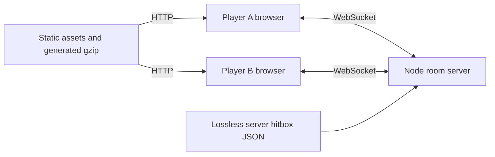

# Architecture

Two browsers communicate with one Node.js room process over same-origin WebSockets. The same HTTP server serves the UI, assets, animation data and sounds.

## Ownership

- **Server:** room admission, loadouts, input acceptance, ammo/reload/fire deadlines, movement/collision, tracing/damage, scoring, respawns, win/rematch, and short reconnect handling.
- **Browser:** camera/input, predicted movement, Three.js rendering, original FP/TP clips, sounds/VFX, shop, settings and loading/recovery UI.
- **Shared modules:** weapon parameters, movement/collision, hitbox curves and tracing helpers. Presentation does not grant damage authority.

## Entry and switching

`public/arena-preparation.mjs` starts after a room request. Two workers prepare every playable item. Successful items are kept across retries, and initial entry waits for the complete set. `scene.mjs` retains FP models/controllers; `opponent.mjs` retains TP models/actions.

Original grip/ADS references are prepared without changing the player's loadout or dispatching equip audio. The final stage uploads textures, compiles materials, and draws offscreen to allocate geometry/skinning buffers. Visibility, culling and render targets are restored. Later purchases use resident resources. Esc/settings and leave actions still cancel stale entry callbacks.

## Memory and delivery

The original generated source tables remain versioned. Node reads equivalent `server-data/` JSON to avoid parsing giant JS literals. The generator manifest and verification tool check source/data equality.

The build losslessly recompresses embedded PNGs and removes only Vandal images already replaced by its loader before display. Geometry, animation samples, texture dimensions, alpha and pixel values are preserved. Generated runtime/gzip files are ignored by Git. Static delivery streams with backpressure and ETag revalidation rather than buffering all simultaneous model downloads in server memory.

## Prototype boundaries

The implementation has no accounts, ranked matchmaking, durable match storage or production anti-cheat system. Agent selection does not imply 21 separately implemented original rigs. Engineering approximations and visual/reference limitations are recorded in [verification](VERIFICATION.md).
